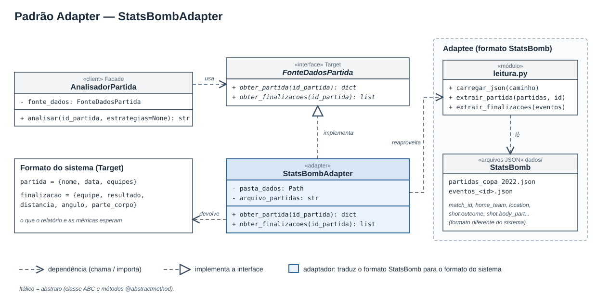

# Padrão Adapter — `StatsBombAdapter`

## Problema

Os dados das partidas vêm da StatsBomb, que usa um formato próprio:

- a partida tem `match_id`, `match_date`, `home_team.home_team_name` e `away_team.away_team_name`
- cada chute é um evento com `type.name == "Shot"`, `location: [x, y]`, `shot.outcome.name` e `shot.body_part.name`

O resto do sistema (relatório e métricas) espera outro formato:

- partida: `{"nome", "data", "equipes"}`
- finalização: `{"equipe", "resultado", "distancia", "angulo", "parte_corpo"}`

Antes, essa conversão era feita por funções soltas em `leitura.py`, e quem precisava dos dados (o `AnalisadorPartida`) tinha que saber o nome dos arquivos JSON, a pasta onde eles ficam e quais funções chamar em cada um. O sistema ficava preso à StatsBomb: trocar de fonte de dados obrigaria a mexer em quem usa a leitura.

## Solução

Foi criada a interface `FonteDadosPartida` (`codigo/adapter.py`), que define o que o sistema precisa de qualquer fonte de dados:

```python
obter_partida(id_partida)       # -> {"nome", "data", "equipes"}
obter_finalizacoes(id_partida)  # -> [{"equipe", "resultado", "distancia", "angulo", "parte_corpo"}, ...]
```

A classe `StatsBombAdapter` implementa essa interface. Por dentro, ela abre os JSONs da StatsBomb e reaproveita as funções de `leitura.py` (`carregar_json`, `extrair_partida` e `extrair_finalizacoes`), sem reescrever nenhum cálculo.

O `AnalisadorPartida` passou a receber uma `FonteDadosPartida` e, se nenhuma for informada, usa o `StatsBombAdapter`:

```python
AnalisadorPartida()                     # usa o StatsBombAdapter
AnalisadorPartida(StatsBombAdapter())   # mesma coisa, explícito
```

| Papel no padrão | No projeto |
|---|---|
| Target | `FonteDadosPartida` |
| Adapter | `StatsBombAdapter` |
| Adaptee | JSONs da StatsBomb e funções de `leitura.py` |
| Client | `AnalisadorPartida` |

## Por que Adapter

- **Separa o formato externo do formato interno.** Só o adaptador conhece a estrutura da StatsBomb; o relatório e as métricas continuam trabalhando com o formato do sistema.
- **Facilita trocar ou adicionar fontes de dados.** Para usar dados de outro fornecedor (Opta, Wyscout, um CSV), basta criar outro adaptador que implemente `FonteDadosPartida`, sem mudar o `AnalisadorPartida`, o relatório ou as métricas.
- **Reaproveita o código existente.** As funções de `leitura.py` não foram reescritas nem alteradas; o adaptador só organiza o acesso a elas atrás de uma interface.
- **Deixa a fachada mais simples.** O `AnalisadorPartida` não precisa mais saber nomes de arquivos nem a pasta dos dados: só pede a partida e as finalizações à fonte de dados.

## Como foi verificado que não mudou o resultado

- `test_obtem_a_mesma_partida_que_a_leitura_sem_adapter` e `test_obtem_as_mesmas_finalizacoes_que_a_leitura_sem_adapter` comparam o que o adaptador devolve com o resultado das funções de `leitura.py` chamadas diretamente.
- `test_converte_a_partida_para_o_formato_do_sistema` e `test_converte_as_finalizacoes_para_o_formato_do_sistema` conferem que os dados saem no formato que o sistema espera.
- Os testes do `AnalisadorPartida` (Facade) continuam passando sem alteração.
- A saída de `python main.py` antes e depois da refatoração é igual.
- Todos os testes das histórias continuam passando.

## Diagrama


