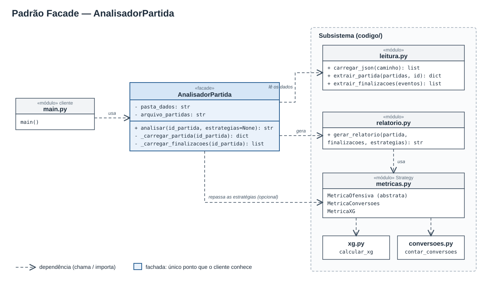

# Padrão Facade — `AnalisadorPartida`

## Problema

Para gerar o relatório de uma partida, o `main.py` precisava conhecer todas as etapas do sistema e chamá-las na ordem certa:

1. carregar o JSON de partidas e o JSON de eventos (`carregar_json`)
2. encontrar a partida pelo id (`extrair_partida`)
3. transformar os eventos em finalizações (`extrair_finalizacoes`)
4. gerar o relatório com as métricas (`gerar_relatorio`)

Ou seja, quem usa o sistema tinha que saber os nomes dos arquivos, a pasta dos dados e a sequência dos módulos. Qualquer mudança na leitura (como o Adapter da StatsBomb) obrigaria a mexer em todos os lugares que fazem essa sequência.

## Solução

A classe `AnalisadorPartida` (`codigo/analisador.py`) virou o único ponto de entrada. Ela recebe o id da partida e devolve o relatório pronto:

```python
AnalisadorPartida().analisar(3869685)
```

Por dentro, ela chama a leitura, o relatório e as métricas, mas quem usa não precisa saber disso. O `main.py` passou de 4 chamadas para 1.

## Por que Facade

- **Esconde a ordem das etapas.** A sequência leitura → cálculo → relatório fica num lugar só.
- **Diminui o acoplamento.** O `main.py` agora depende só do `AnalisadorPartida`, e não de `leitura.py` e `relatorio.py`. Quando o Adapter substituir as funções de leitura, só a fachada muda.
- **Não tira nada.** Os módulos continuam podendo ser usados direto (os testes de cada história fazem isso), e a fachada repassa as estratégias do Strategy para quem quiser escolher as métricas.

## Como foi verificado que não mudou o resultado

- `test_gera_o_mesmo_relatorio_que_o_fluxo_sem_facade` compara o relatório da fachada com o relatório montado à mão, chamando os módulos como o `main.py` fazia antes.
- A saída de `python main.py` antes e depois da refatoração é igual.
- Todos os testes das histórias continuam passando.

## Diagrama


